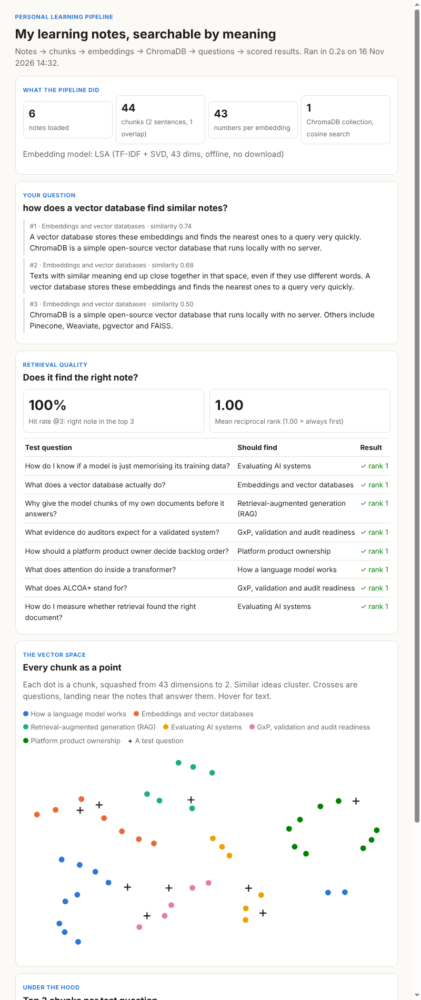

# learning-rag

Hands-on prototypes I build to learn AI and platform engineering by doing.

| Project | What it shows |
|---|---|
| **This folder** | Learning notes → ChromaDB vector database, with retrieval evaluation built in |
| [`sleep-slo/`](sleep-slo/) | My sleep run like a production service: Service Level Objectives, error budget, evaluation gate, ChromaDB, Kubernetes, Terraform and CI/CD |

## Learning notes → ChromaDB

One command loads my notes, splits them into chunks, embeds them, stores them in ChromaDB, runs a set of test questions, scores how well the search found the right note, and opens an HTML report.



## Run it

```bash
pip install -r requirements.txt
python run_pipeline.py
```

Ask your own question:

```bash
python run_pipeline.py --ask "what is ALCOA+?"
```

Use a neural embedding model (downloads once, needs internet):

```bash
python run_pipeline.py --embed minilm
```

## What happens

| Step | What it does |
|---|---|
| 1. Load | Reads every `notes/*.md` file (first line `# Title`) |
| 2. Chunk | Splits into 2-sentence chunks with 1 sentence of overlap, so ideas aren't cut in half |
| 3. Embed | Turns each chunk into a vector. Default is LSA (TF-IDF + SVD), which runs offline; `--embed minilm` uses all-MiniLM-L6-v2 |
| 4. Store | Saves chunks, vectors and source metadata in a local ChromaDB collection (cosine distance) |
| 5. Evaluate | Runs `questions.json` and scores **hit rate @3** (right note in the top 3) and **MRR** (how high it ranked) |
| 6. Report | Writes `report.html`: pipeline stats, scores, a 2D map of the vector space, and the top chunks per question |

## Why the eval step

A retrieval system you can't measure is one you can't trust or improve. Each test question names the note that should answer it, so every change to chunking, embeddings or notes gets a score you can compare with the last run.

## Add your own notes

Drop a `.md` file into `notes/`, add a question to `questions.json` with the note it should find, and run it again.
